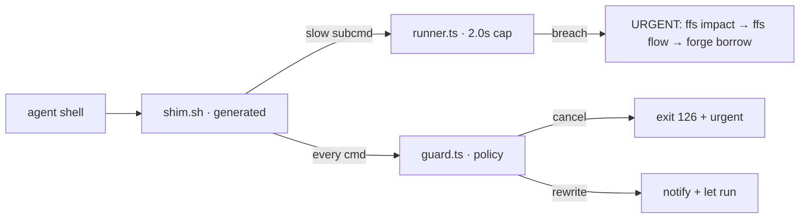

<div align="right">

[](LICENSE)
[](https://github.com/toxicwind/two-sec)
[](https://bun.sh)

</div>

# two-sec

The 2-second rule, first-class: every command an agent runs gets a **2.0s
hard deadline**; breaching = FAILED, and the trigger to **race a faster
alternative** (never wait longer). A command policy guard cancels
error-swallowing and output-destroying commands with an **urgent, AST-driven
must-do notice** the agent sees inline on stdout.

Logic lives in Bun (`policy.ts` → `guard.ts` → `runner.ts`); bash is glue
only — a GENERATED static shim (`shim.sh`, zero bun spawns at runtime).



## Policy classes

| Action | Patterns | Behavior |
| --- | --- | --- |
| **cancel** | `\| true`, `sleep N` | blocked, exit 126, urgent fix notice |
| **rewrite** | `>/dev/null`, `2>&1`, `\| head/tail/wc`, `head/tail -c` | notified + instructed to rerun full-output |
| **slow-route** | git push/fetch/clone, bun install/test, npm ci, cargo/go builds, gitleaks, make… | deadline runner: breach = urgent AST plan |

## The breach = AST-find-faster contract

A breach notice is not a nag — it names the exact commands to race faster:

1. `ffs impact <slow-symbol>` — blast radius, right fix point
2. `ffs flow <slow-symbol>` — def+body+callees, find the O(n²)/spawn storm
3. `forge borrow '<what the command does>'` — external faster prior art
4. or background it — never wait longer

## Install

```bash
bash -c 'echo "export BASH_ENV=$HOME/estate/ranch/two-sec/shim.sh" >> ~/.bash_profile'
bun run src/cli.ts init > shim.sh   # regenerate after policy edits
bun test                             # 6/6 policy tests
```

## Prior art posture

Borrowed ideas (papers are not the breakthrough, this integration is):
guardrail-DoS resilience (never bypassable via obfuscation), hybrid
static+dynamic tool-call analysis, recoverable execution (AgentRewind-style
"here's what to do instead" recovery in every notice).

## License

MIT — see [LICENSE](LICENSE).
