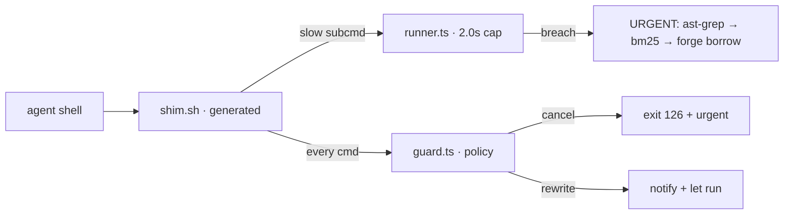

<div align="right">

[](LICENSE)
[](https://github.com/toxicwind/kairos)
[](https://bun.sh)

</div>

# kairos (καιρός)

_The opportune moment_ — the 2-second rule, first-class: every command an agent
runs gets a deadline (default **2.0s**) that breaching = FAILED, the trigger to
**race a faster alternative** (never wait longer). The deadline and hard-cancel
behavior are **project-overridable** via `.two-sec/policy.json`, so the guard
can be tamed for long autonomous runs instead of fighting the agent. A command
policy guard cancels error-swallowing and output-destroying commands with an
**urgent, AST-driven must-do notice** the agent sees inline on stdout.

Logic lives in Bun (`policy.ts` → `guard.ts` → `runner.ts`); bash is glue
only — a GENERATED static shim (`shim.sh`, zero bun spawns at runtime).



## What the runner does

- **Pipeline splitter** — `|`, `&&`, `;` are split into segments; each is
  ban-checked and deadline-checked individually.
- **Truncation rewriter** — `| head/tail/wc -l` is rewritten so the FULL output
  persists to the run-fast session file and only the window is shown. Never
  loses evidence.
- **Live-persist sink** — every chunk flushes to stdout + the session file
  synchronously (async execution preserved, nothing buffered-and-lost).
- **Hard blocks** — banned tools (`find`→`fd`, `cat`→read tool, `sed`→ast-grep,
  `head/tail`, …) are refused with the WHY + the exact replacement to run.
- **Deadline bumps** — legitimately-slow-but-necessary commands get wider
  windows: `typecheck`/`tsgo`/`turbo` 180s, `git status` 20s, `ffs glob/find`
  10s. Base is 2.0s unless a project policy widens it.

## Maximalize for autonomous LLM use

The guard is disciplined by default, not punitive. Configure any checkout with
a `.two-sec/policy.json` (walked up from cwd):

```json
{
  "deadlineS": 60,
  "disableBans": [
    "pipeline truncation (head/tail/wc)",
    "'2>&1' merges stderr into stdout",
    "output discarded to /dev/null",
    "byte/slice truncation in output",
    "blocking sleep"
  ]
}
```

- `deadlineS` widens the kill timer **and** (post-10-20 fix) the breach
  **verdict**, so long work isn't trench-scolded for crossing 2.0s.
- `disableBans` removes friction rules by `reason`; `extraBans` adds them.
- `.two-sec/ignore` — regex entries that never fire.
- `run-fast --deadline SECONDS <cmd>` for a one-off wider window.
- Keep `| true` (exit-code-swallowing) banned — it removes a real safety
  property.

Full guide: [`docs/GUARD_GUIDE.md`](docs/GUARD_GUIDE.md).

## Policy classes

| Action         | Patterns                                                                                   | Behavior                             |
| -------------- | ------------------------------------------------------------------------------------------ | ------------------------------------ |
| **cancel**     | `\| true`, `sleep N`                                                                       | blocked, exit 126, urgent fix notice |
| **rewrite**    | `>/dev/null`, `2>&1`, `\| head/tail/wc`, `head/tail -c`                                    | full output persisted, window shown  |
| **slow-route** | git push/fetch/clone, bun install/test/typecheck, npm ci, cargo/go builds, gitleaks, make… | deadline runner with bumped window   |

## The breach = AST-find-faster contract

A breach notice is not a nag — it names the exact commands to race faster:

1. `ast-grep run -p '<pattern>'` — tree-sitter structural AST search (exact)
   `bm25 <query>` — semantic recall over symbols/comments
2. `ffs flow <symbol>` / `ffs impact <symbol>` — def+body+callees + blast radius
3. `forge borrow '<what the command does>'` — external faster prior art
4. or background it — never wait longer

## Install

```bash
bash -c 'echo "export BASH_ENV=$HOME/estate/ranch/kairos/shim.sh" >> ~/.bash_profile'
bun run src/cli.ts init > shim.sh   # regenerate after policy edits
bun test                             # policy tests
```

## Prior art posture

Borrowed ideas (papers are not the breakthrough, this integration is — the
synthesis of a deadline runner + command-policy guard + AST-driven recovery):

- **Recoverable execution** — "here's what to do instead" recovery in every
  notice, the AgentRewind family: [JWang-Langer/agentrewind](https://github.com/JWang-Langer/agentrewind)
  (framework-agnostic LLM-agent record/replay/revert/diff) and
  [ESSAILab/AgentRewindRT](https://github.com/ESSAILab/AgentRewindRT) (agent
  sandbox with anomaly-detection morph + rollback).
- **Guardrail-DoS / bypass-resilience** — never bypassable via obfuscation;
  the same threat model as LLM-guardrail evasion research (BrokenGuard-style
  adversarial-prompt studies of "can you hide a forbidden action in an
  obfuscated command and still get past the guard").
- **Hybrid static+dynamic tool-call analysis** — the guard inspects both the
  command line (static) and the running process / output stream (dynamic), so a
  truncation or redirect is caught at execution, not just at parse time.
- **Upstream crash-driven fixing** — the "no full rebuild for a hotfix" ethos
  comes from routing around [oven-sh/bun crash fixes](https://github.com/oven-sh/bun/pulls)
  via prebuilt upgrades + pure-JS fallbacks instead of recompiling the engine
  ([#39815](https://github.com/oven-sh/bun/pull/39815),
  [#39967](https://github.com/oven-sh/bun/pull/39967)).

## License

MIT — see [LICENSE](LICENSE).
